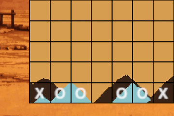
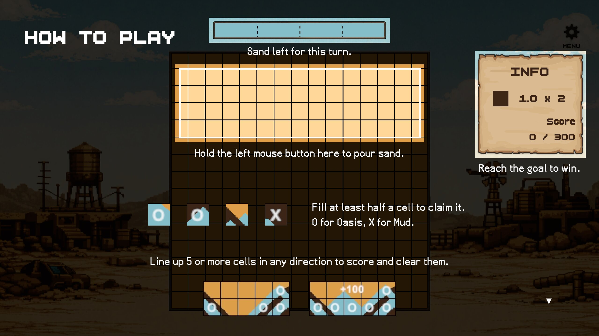
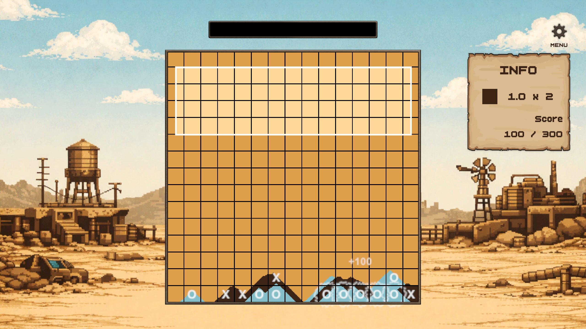
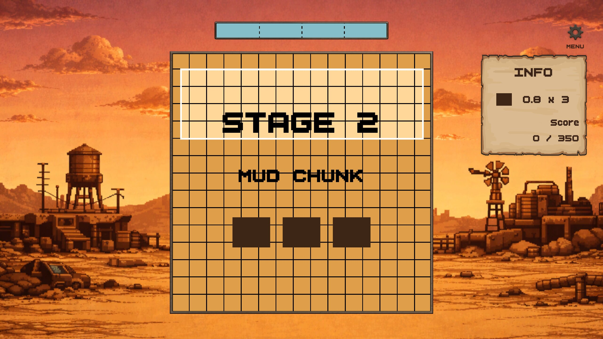
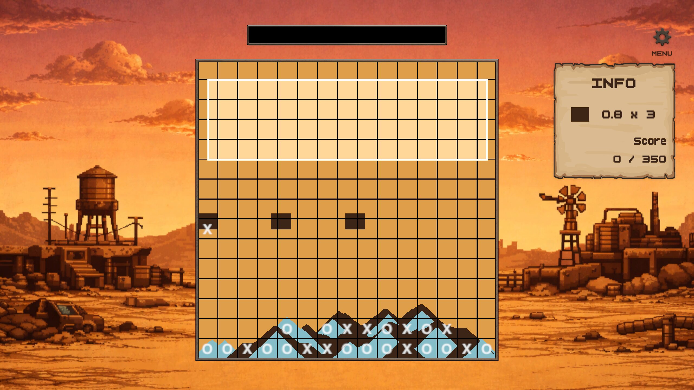

# Sand Bingo

   
  
   

<h3 align="center">Five-in-a-row on a falling-sand board</h3>

   
   
  
  &nbsp;
  
   
   
  
  &nbsp;
  
   
   

## About

- Genre : Falling-sand puzzle
- Modes : Stages (Easy, Normal, Hard, Custom), Versus
- Multiplayer : Remote Play Together (Steam version)
- Platform : Windows 10, 11 (64-bit)
- Engine : Unity 2022.3.62f3

## Credits

### UI

- [Dark Brown GUI kit](https://assetstore.unity.com/packages/2d/gui/dark-brown-gui-kit-201086) - ARCEY
- [Fantasy Wooden GUI : Free](https://assetstore.unity.com/packages/2d/gui/fantasy-wooden-gui-free-103811) - Black Hammer
- [Person Icon (Flaticon)](https://www.flaticon.com/free-icons/person) - Md Tanvirul Haque

### Font

- [BoldPixels Font](https://assetstore.unity.com/packages/2d/fonts/boldpixels-font-332078) - YukiPixels
- [Terrarum Sans Bitmap](https://github.com/curioustorvald/Terrarum-sans-bitmap) - CuriousTorvald

### BGM

- [Adventure Music and SFX](https://assetstore.unity.com/packages/audio/music/adventure-music-and-sfx-221545) - whatsoundsnice (resolution - charlie)
- [Peaceful Piano (FREE LOOPS)](https://assetstore.unity.com/packages/audio/music/peaceful-piano-free-loops-367410) - Valerio Pellegri Audio

### SFX

- [SFX Essentials 14 - DUST](https://assetstore.unity.com/packages/audio/sound-fx/sfx-essentials-14-dust-286538) - InspectorJ Audio
- [Western Audio & Music](https://assetstore.unity.com/packages/audio/sound-fx/western-audio-music-67788) - John Leonard French
- [Free UI Soundpack](https://assetstore.unity.com/packages/audio/sound-fx/free-ui-soundpack-239372) - Cyrex

### Steamworks

- [Steamworks.NET](https://github.com/rlabrecque/Steamworks.NET) - Riley Labrecque

### Generative AI

- C# scripts : Claude Sonnet 4.5 - 5, Claude Opus 4.6 - 5.5
- Images : GPT Image 2.0, Grok Aurora
- This game contains AI-generated images.
- No generative AI is used during gameplay.